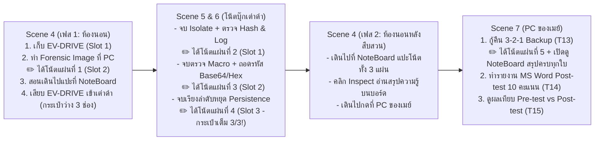

# การออกแบบระบบสะสมโน้ตองค์ความรู้ (NoteBoard Progression) และ Post-test ใน Scene 7

**วันที่**: 2026-11-05  
**หัวข้อ**: ระบบสะสมโน้ตองค์ความรู้ลงกระเป๋า 3 ช่อง (Inventory -> NoteBoard Inspect) แบบไร้ลูป (Loop-Free Progression) และการวัดผล Post-test 10 คะแนนใน `Scene 7`

---

## 1. เป้าหมายและเหตุผล (Intent & Why)

1. **ให้ผู้เล่นเห็นความก้าวหน้าของการเรียนรู้ (Visible Learning Progression)**:
   - เปลี่ยนจากหน้าต่างสรุปความรู้แบบข้อความยาวหน้าเดียวตอนจบเกม ให้กลายเป็น **โน้ตสรุปองค์ความรู้ (Knowledge Notes)** ที่ค่อยๆ เกิดขึ้นเมื่อผู้เล่นทำภารกิจสำเร็จในแต่ละช่วง
2. **เชื่อมโยง Gameplay Mechanic เข้ากับกระเป๋า 3 ช่อง (`InventoryManager`) และกระดาน `NoteBoard`**:
   - เมื่อเกิดองค์ความรู้ใหม่ จะมี **เสียงดินสอเขียนโน้ต (Pencil Writing SFX)** และเพิ่มไอเทมโน้ตเข้ากระเป๋า (`MAX_SLOTS = 3`)
   - โน้ตที่อยู่ในกระเป๋าจะยังเปิดอ่านรายละเอียดไม่ได้ ผู้เล่นต้องเดินไปแปะที่กระดาน `NoteBoard` ในห้องนอนก่อน จึงจะคลิก **Inspect** เพื่ออ่านเนื้อหาสรุปองค์ความรู้ของแผ่นนั้นได้
3. **ป้องกันการเกิดลูป (Loop-Free Flow)**:
   - ป้องกันทั้ง **Gameplay Loop ที่น่าเบื่อ** (ไม่ต้องเดินเข้า-ออกหน้าจอเต่าดำกลางคันหลายรอบ) และ **Scene State Loop** (ไม่เกิดบั๊กวนฉากซ้ำระหว่าง `Scene 4`, `Scene 5`, `Scene 6`, `Scene 7`) โดยใช้การเดินหน้าแบบ One-Way Phase State
4. **ครบลูปการวัดผลวิจัย Pre-test (`T04`) -> Post-test (`T14`)**:
   - เปลี่ยนด่าน `T14` ใน `Scene 7` จาก Dropdown 3 ข้อ เป็นการทำรายงาน `Report_Final.docx` ในหน้าต่าง **MS Word (Post-test 10 คะแนน)** ที่คู่ขนานกับ Pre-test ใน `Scene 3` พร้อมแสดงผลเปรียบเทียบคะแนน Pre-test vs Post-test ในหน้า `KSA_Evaluation_UI` (`T15`)

---

## 2. ขอบเขตงานและข้อจำกัด (Goals, Non-Goals & Constraints)

- **Goals**:
  - ขยายกระดาน `NoteBoard` (`res://scenes/initial/note_board.tscn` และ `note_board.gd`) ให้กว้างขึ้น รองรับโพสต์อิทองค์ความรู้ขนาดกะทัดรัดที่ **คลิกเพื่อเปิดอ่านรายละเอียด (Inspect Modal)** ได้
  - สร้างเสียงเอฟเฟกต์ดินสอขีดเขียน (Procedural/AudioStreamWAV Pencil SFX) และแบนเนอร์แจ้งเตือนเมื่อได้รับโน้ตความรู้ใหม่เข้ากระเป๋า
  - ปรับการไหลของฉาก (`Scene 4` -> `Scene 5` -> `Scene 6` -> กลับห้องนอน `Scene 4 (เฟสหลังสืบสวน)` -> `Scene 7`) ให้เป็นเส้นตรงไปข้างหน้า ไม่เกิดการลูปซ้ำ
  - อัปเกรด `T14` (`Puzzle_Last_Boss_Summary`) ให้เป็น **MS Word Post-test 10 คะแนน** และเชื่อมคะแนน Pre/Post เข้ากับ `TelemetryManager`
- **Non-Goals**:
  - ไม่แก้ไขไฟล์ `game_client/ui/os_simulation/notebook_screen.tscn` ซึ่งถูกล็อกตามกฎเหล็กของโปรเจกต์
  - ไม่บังคับให้ผู้เล่นต้องสลับฉากออกกลางคันระหว่างทำด่านย่อยใน `Scene 6`

---

## 3. แนวทางที่เลือก (Selected Approach: Loop-Free Bedroom Hub)

พิจารณาจาก 2 แนวทาง:
1. **แนวทางที่ 1 (เลือกใช้)**: ใช้ฉากห้องนอน (`Scene_04_Investigation_Intro`) เป็นจุดเชื่อม 2 จังหวะ (ก่อนเปิดเต่าดำ และหลังสืบสวนบนเต่าดำเสร็จก่อนไปเปิด PC ของเมย์) โดยบันทึกสถานะเฟสไว้ใน `InventoryManager` เพื่อไม่ให้เกิดการลูปกลับไปฉากเดิม
2. **แนวทางที่ 2 (ตัดออก)**: ฝังแผนที่ห้องนอนซ้อนไว้ข้างหลัง `Scene 5`, `Scene 6`, `Scene 7` ทุกฉาก (ซ้ำซ้อนและเสี่ยงกระทบ Scene Tree เดิม)

---

## 4. รายละเอียดการไหลของเกมแบบไม่เกิดลูป (Loop-Free Progression & 3-Slot Mechanic)

เพื่อไม่ให้ผู้เล่นต้องเดินเข้า-ออกหน้าจอคอมพิวเตอร์ซ้ำไปซ้ำมา ระบบจะจัดจังหวะกระเป๋า 3 ช่อง (`MAX_SLOTS = 3`) ให้พอดีกับจำนวนเฟสการเล่นดังนี้:

### รายละเอียดโน้ตองค์ความรู้และการขยายเป็นโพสต์อิทบน `NoteBoard`
เมื่อผู้เล่นนำโน้ตจากกระเป๋าไปแปะที่ `NoteBoard` โพสต์อิทบนกระดานจะถูกปลดล็อกตามหมวดความรู้ (รวม **8 โพสต์อิทย่อยบนกระดาน** ที่คลิก Inspect เพื่ออ่านเนื้อหาเจาะลึกได้):

| โน้ตในกระเป๋า (Inventory Item) | จังหวะที่ได้รับ (พร้อมเสียงดินสอเขียน) | โพสต์อิทที่ปลดล็อกบน `NoteBoard` (คลิกเพื่อ Inspect เนื้อหาเต็ม) |
| :--- | :--- | :--- |
| **1. `note_forensic_prep`** *"โน้ต: การเก็บสำเนาหลักฐาน"* | `Scene 4`: หลังทำ Forensic Image ลงแฟลชไดรฟ์ `EV-DRIVE` ที่เครื่อง PC | **📌 แผ่นที่ 1: Forensic Image & Chain of Custody** (เหตุผลที่ต้องคัดลอกหลักฐานแบบ Read-only ลงไดรฟ์แยก) |
| **2. `note_isolation_logs`** *"โน้ต: การแยกเครื่อง & ตรวจ Log"* | `Scene 6`: หลังผ่านการ Isolate เต่าดำ (`T05`), ตรวจ MD5 (`T08`), Event Log (`T06`) และ Drive Log (`T07`) | **📌 แผ่นที่ 2: Isolated Environment (เต่าดำ)** (ตัดเน็ต/ไม่ผูกบัญชี/ไม่มีไฟล์สำคัญ) **📌 แผ่นที่ 3: MD5 Hash Integrity** (การเทียบค่า Hash กับ Manifest) **📌 แผ่นที่ 4: Event Log & Typosquatting** (ไทม์ไลน์ `19:02:10` และโดเมนปลอม `universcity.example`) |
| **3. `note_malware_payload`** *"โน้ต: โครงสร้างมาโคร & เพย์โหลด"* | `Scene 6`: หลังตรวจโครงสร้าง `.docx` (`T09`) และถอดรหัส Base64/Hex (`T10`–`T11`) | **📌 แผ่นที่ 5: Word Macro (`vbaProject.bin`)** (จุดซ่อนโค้ด VBA ในเอกสาร) **📌 แผ่นที่ 6: Obfuscation (`Base64/Hex`) & `FILE_WIPE`** (โปรเซส `Office_Update_Helper` และโหมดทำลายไฟล์) |
| **4. `note_persistence_stop`** *"โน้ต: การตัดวงจรฝังตัว"* | `Scene 6`: หลังเรียงลำดับหยุด Persistence 7 ขั้นตอน (`T12`) สำเร็จ *(กระเป๋าเต็ม 3/3 พอดี)* | **📌 แผ่นที่ 7: 7-Step Persistence Containment** (ทำไมต้องเข้า Safe Mode และปิด Scheduled Task ก่อนกู้ไฟล์) |
| **5. `note_backup_recovery`** *"โน้ต: กฎสำรองข้อมูล 3-2-1"* | `Scene 7`: หลังตั้งค่ากู้คืนข้อมูลสำรอง 3-2-1 (`T13`) สำเร็จ | **📌 แผ่นที่ 8: 3-2-1 Backup & Safe Recovery** (การเลือกจุดเวลาก่อนเกิดเหตุ `18:55`, ไดรฟ์แยก, และปิด Cloud Sync) |

---

## 5. การป้องกันลูป (Anti-Loop Safeguards)

1. **State Machine แบบเดินหน้าทางเดียว (`InventoryManager.investigation_phase`)**:
   - `PHASE_0_INITIAL`: เริ่ม `Scene 4` (คุยพี่มาร์ช -> หยิบ `EV-DRIVE` -> ทำ Forensic Image ได้โน้ตใบแรก -> สอนแปะที่ `NoteBoard` -> เปิดเต่าดำเข้า `Scene 5`)
   - `PHASE_1_TAODAM_ACTIVE`: อยู่ใน `Scene 5` และ `Scene 6` (เมื่อเสียบ `EV-DRIVE` เข้าเต่าดำแล้ว จะนำ `EV-DRIVE` ออกจากมือเพื่อให้กระเป๋ามี 3 ช่องว่างสำหรับรับโน้ตสืบสวน 3 ใบจนเต็ม `3/3`)
   - `PHASE_2_TAODAM_DONE_PIN_NOTES`: เมื่อจบ `Scene 6` ตัวเกมพากลับมาที่ห้องนอน (`Scene 4`) โดยล็อกไม่ให้กลับเข้า `Scene 5/6` ซ้ำอีก! เป้าหมายในห้องนอนจะเปลี่ยนเป็น: **"นำโน้ตในกระเป๋าทั้ง 3 ใบไปแปะที่กระดาน NoteBoard แล้วเดินไปที่เครื่อง PC ของเมย์เพื่อกู้คืนข้อมูล"**
   - `PHASE_3_RECOVERY_AND_POSTTEST`: เมื่อแปะโน้ตครบและกดที่ PC ของเมย์ จะเข้าสู่ `Scene 7` เพื่อทำ `3-2-1 Backup (T13)` -> เปิดกระดาน `NoteBoard` สรุปครบทั้ง 8 แผ่น -> ทำรายงาน **MS Word Post-test 10 คะแนน (`T14`)** -> ดูผลประเมิน `KSA_Evaluation_UI (T15)`
2. **กติกาการอ่านโน้ต (Inspect Rule)**:
   - ขณะโน้ตอยู่ในกระเป๋า 3 ช่อง (`InventoryBar`): แสดงเฉพาะชื่อไอเทมสั้นๆ เช่น `"โน้ตปริศนา #2 (นำไปแปะที่บอร์ดเพื่ออ่าน)"`
   - เมื่อถือโน้ตแล้วกด `[Spacebar]` ที่ `NoteBoard`: โน้ตจะถูกย้ายจากกระเป๋าไปติดบนบอร์ด (คืนช่องว่างในกระเป๋าทันที) และผู้เล่นสามารถ **คลิกที่โพสต์อิทแต่ละใบบนบอร์ด** เพื่อเปิดหน้าต่างขยายอ่านเนื้อหาสรุปองค์ความรู้ได้เต็มที่

---

## 6. การออกแบบ Post-test 10 คะแนนใน `Scene 7` (`T14`)

- หลังจากกู้ไฟล์ `Report_Final.docx` ด้วย 3-2-1 Backup (`T13`) สำเร็จและทบทวน `NoteBoard` ครบทั้ง 8 แผ่นแล้ว:
  - ด่าน `T14` จะเปิดหน้าต่าง **MS Word (`Report_Final.docx` — โหมด Post-test)** ให้เมย์ทำรายงานส่งอาจารย์ให้เสร็จสมบูรณ์
  - โครงสร้างข้อสอบคู่ขนานกับ Pre-test เต็ม **10 คะแนน** (Dropdown เติมคำในย่อหน้า 6 คะแนน + Visual CheckBox 2 คะแนน + Flowchart Drag-and-Drop 2 คะแนน)
  - บันทึกคะแนน `posttest_score` (`0–10`) ลง `TelemetryManager` และแสดงการเปรียบเทียบ **`Pre-test: X/10 -> Post-test: Y/10 (พัฒนาการ +Z)`** ในหน้าสรุปผล `KSA_Evaluation_UI` (`T15`)
